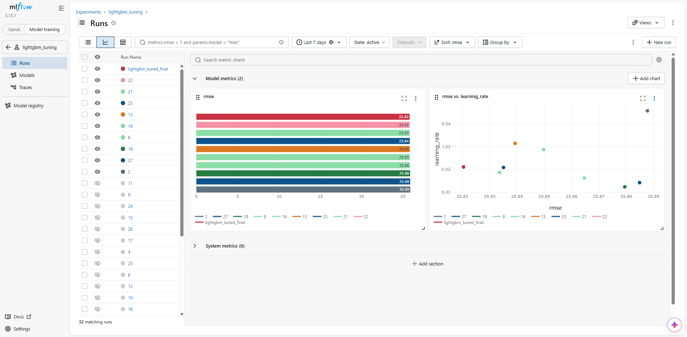
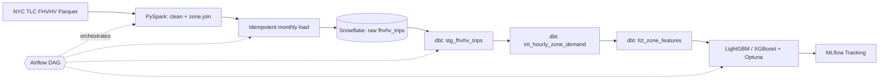
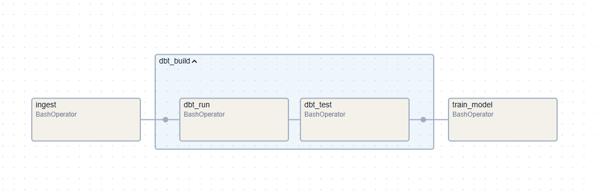

# 🚕 NYC Dynamic Surge Predictor

[](https://github.com/sejalnimkar/NYC-Taxi-Dynamic-Surge-Predictor/actions/workflows/ci.yml)

An end-to-end data engineering + ML pipeline that forecasts **hourly ride demand for each of NYC's 265 taxi zones, 1–3 hours ahead**, using 40M+ Uber/Lyft (FHVHV) trip records. Built with PySpark, Snowflake, dbt, LightGBM/XGBoost, MLflow, and Airflow, all containerized with Docker. The dbt project and the models also run on a local DuckDB file, so the whole thing can be tried and is tested in CI without a Snowflake account.

Interactive pickup-density map: [`notebooks/nyc_taxi_zones.html`](notebooks/nyc_taxi_zones.html) (download and open in a browser).

## Results

### Model selection (one hour ahead, January validation)

From the exploration notebook (`notebooks/Model_Training.ipynb`):

| Model | RMSE (trips/zone/hour) |
|---|---|
| Naive baseline (lag-1h) | 35.64 |
| HistGradientBoosting | 26.50 |
| XGBoost | 26.61 |
| LightGBM | 26.03 |
| **LightGBM (Optuna-tuned, 90 trials)** | **25.82** |
| **Out-of-sample: February holdout** | **26.18** |

- ~27% lower error than the naive baseline
- Only ~1.4% degradation on a fully unseen month, so the model generalizes

### 1, 2 and 3 hours ahead (February holdout)

`src/train.py` trains one model per horizon and scores each on February against three model-free baselines (latest visible hour, same hour yesterday, same hour last week), reporting RMSE, MAE and WAPE overall and by borough. Each horizon only uses features that would exist at forecast time (see [Feature engineering](#3-feature-engineering-dbt)).

<!-- RESULTS:START -->
February 2026, never seen in training or tuning: 178,080 zone-hours (265 zones x 672 hours). RMSE in trips per zone per hour.

| Horizon | Best baseline (RMSE) | LightGBM, recent features | LightGBM + daily/weekly lags | Improvement vs. best baseline | WAPE |
|---|---|---|---|---|---|
| 1h | 37.28 (persistence) | 26.15 | **24.99** | 33% | 12.4% |
| 2h | 50.07 (same hour last week) | 33.99 | **32.00** | 36% | 15.5% |
| 3h | 50.07 (same hour last week) | 39.16 | **36.92** | 26% | 17.1% |

- The "best baseline" is the strongest of three model-free forecasts at that horizon: the latest visible hour, the same hour yesterday, or the same hour last week.
- WAPE is total absolute error divided by total demand, for the model in bold.
- Adding the daily and weekly lags helped more on the January validation week than on February (15-18% vs. 4-6% lower RMSE, depending on horizon), so treat the size of that gain with caution.
- Full table with MAE and a per-borough breakdown: [`reports/holdout_metrics.md`](reports/holdout_metrics.md). These numbers were produced by `src/train.py` on the real hourly aggregates using the DuckDB target.
<!-- RESULTS:END -->



## Architecture



## Tech Stack

| Layer | Tools |
|---|---|
| Ingestion & cleaning | PySpark, Folium |
| Warehouse | Snowflake |
| Transformation & testing | dbt (staging, intermediate, features, 26 data tests) |
| Modeling | LightGBM, XGBoost, scikit-learn, Optuna |
| Experiment tracking | MLflow (SQLite backend) |
| Orchestration | Airflow |
| Infrastructure | Docker Compose (Jupyter/Spark, MLflow, Airflow) |
| Tests & CI | pytest (41 tests, including PySpark transforms), ruff, GitHub Actions, DuckDB |

## Pipeline Walkthrough

### 1. Ingestion & cleaning (PySpark)
- Loaded January and February 2026 FHVHV parquet files (~20.9M and ~19.9M raw rows)
- Dropped duplicates and invalid trips (~0.5% of rows), joined the TLC zone lookup, and derived `pickup_hour`, `day_of_week`, `is_weekend`
- Cleaned counts: **20,835,763** (Jan) and **19,867,132** (Feb)
- Uber/Lyft split: ~73% / 27%

### 2. Warehouse & staging (Snowflake + dbt)
- Bulk-loaded via `PUT` + `INFER_SCHEMA` + `COPY INTO` (`src/load.py`)
- The load is **idempotent per month**: it deletes that month's rows and re-copies them in one transaction, then checks the row count, so a re-run or a failed run can never double-load or half-load a month
- `stg_fhvhv_trips` converts microsecond-epoch integers to timestamps and enforces types
- **9 dbt tests** on staging (`not_null`, `accepted_values`, `relationships`) validate keys, license codes, and zone IDs

### 3. Feature engineering (dbt)
- `int_hourly_zone_demand`: hourly pickup counts per zone
- `fct_zone_features`: a zero-filled zone × hour grid (**265 zones × 744 hours = 197,160 rows** for January) with:
  - Lag features (1–5h, plus same hour yesterday and same hour last week)
  - Rolling averages (3h / 24h) that **exclude the current hour** to prevent leakage
  - Calendar flags, and a holiday flag joined from a `holidays` seed
- **Features are grouped by forecast horizon.** A forecast made *h* hours ahead may only use demand at least *h* hours old, so the 2-hour model gets lags 2–4h and rolling windows that end 2 hours back, and so on. The rule lives in one place (`src/features.py`) and is unit-tested.
- Five custom dbt tests guard the table the models train on: one row per zone-hour, a complete zone × hour grid, no missing hours (the lags are row-based, so a gap would silently shift them), trip totals that reconcile to staging, and lag values that match the prior hour

### 4. Modeling & tracking (MLflow)
- Trained naive, HistGBDT, LightGBM, and XGBoost baselines, all logged to MLflow
- 90-trial Optuna search on LightGBM with the native MLflow callback
- Best config: `n_estimators=400, learning_rate=0.0481, max_depth=8, num_leaves=98`
- January used for training/validation; **February held out entirely** for the final evaluation
- The pipeline script (`src/train.py`) reuses the tuned parameters by default (`--n-trials N` re-tunes) and trains one model per horizon

### 5. Orchestration (Airflow)
`ingest → load` for each month, then `dbt seed → dbt run → dbt test → train_model`, with each step calling into the Jupyter container via `docker exec`. Every step is safe to re-run, and training does not start unless the dbt tests pass.



## Engineering Challenges

- **Forecast-horizon leakage:** The first version described itself as forecasting 1–3 hours ahead but trained a single model on the 1-hour lag, which is only a 1-hour forecast. Features are now selected per horizon so a 3-hour forecast cannot see the last two hours.
- **Train/test leakage:** My first Jan/Feb split accidentally mixed February data into training. I caught it before reporting results, fixed it, and re-ran. The 26.18 figure above is leak-free.
- **Dependency conflicts:** `dbt-snowflake` broke Airflow's pip resolver, so dbt lives in the Jupyter image and Airflow triggers it via `docker exec`.
- **Spark OOM (exit 137):** Fixed by raising WSL2 memory, trimming worker memory, reducing executor cores/shuffle partitions, and removing redundant `.count()` calls.
- **Config persistence:** `profiles.yml` kept vanishing on container restarts, so it now lives in the repo (`.dbt/`) with `--profiles-dir`, using env vars for credentials.
- **Snowflake trial expiry:** Migrated accounts mid-project and rebuilt everything from the repo, which confirmed the dbt project is reproducible.

## Repo Structure

```
├── .dbt/profiles.yml      # dbt targets: Snowflake (dev) and DuckDB (ci); credentials from env vars
├── .github/workflows/     # CI: lint, unit tests, dbt build + training on DuckDB
├── dags/                  # Airflow DAG
├── docker/                # Dockerfiles (Jupyter/Spark, MLflow, Airflow)
├── nyc_surge_predictor/   # dbt project: staging, features, seeds, macros, tests
├── notebooks/             # EDA, staging, feature selection, model exploration
├── reports/               # holdout metrics written by train.py
├── scripts/               # synthetic fixture for the DuckDB demo and CI
├── src/                   # ingest.py, load.py, features.py, evaluate.py, train.py
├── tests/                 # pytest suite
├── docker-compose.yml
├── Makefile
└── .env.example
```

## Getting Started

### Try it without Snowflake (about a minute)

```bash
git clone https://github.com/sejalnimkar/NYC-Taxi-Dynamic-Surge-Predictor.git
cd NYC-Taxi-Dynamic-Surge-Predictor
make install   # Python 3.11+; the Spark unit tests also need Java 17+
make test      # lint + 41 unit tests
make demo      # synthetic trips -> DuckDB -> dbt build (models + 26 tests) -> train all 3 horizons
```

`make demo` uses a small synthetic dataset, so it proves the code runs; its scores mean nothing.

### Full stack (Snowflake + Docker)

```bash
git clone https://github.com/sejalnimkar/NYC-Taxi-Dynamic-Surge-Predictor.git
cd NYC-Taxi-Dynamic-Surge-Predictor
cp .env.example .env     # add your Snowflake credentials
docker compose up -d
```

| Service | URL |
|---|---|
| Jupyter | localhost:8888 |
| MLflow | localhost:5000 |
| Airflow | localhost:8080 |
| Spark UI | localhost:9090 |

Data: download the January and February 2026 FHVHV parquet files and the zone lookup from the [NYC TLC Trip Record page](https://www.nyc.gov/site/tlc/about/tlc-trip-record-data.page) into `data/`, then trigger `surge_predictor_pipeline` in the Airflow UI.

## Limitations

- **Two months of data.** Models train on January only, so they have seen one New Year's Day and one MLK Day. The holiday flag cannot be learned reliably from that, and there is no view of seasonality beyond the week.
- **Batch only.** The pipeline scores a holdout; it does not serve forecasts or write them back to the warehouse.
- **Demand, not price.** "Surge" here means a spike in pickups. TLC data has no surge multiplier.
- **Full refresh.** dbt rebuilds the feature table each run. That is fine at two months; more history would call for an incremental model.

## Future Work
- Add more months and make `fct_zone_features` an incremental dbt model
- Write forecasts back to Snowflake and chart forecast vs. actual by zone in Tableau
- Add weather and event features

## Author
**Sejal**  · [LinkedIn](https://www.linkedin.com/in/sejalnimkar)
