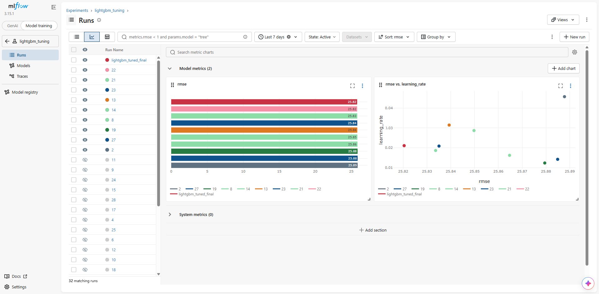
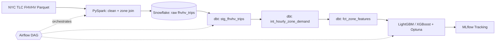
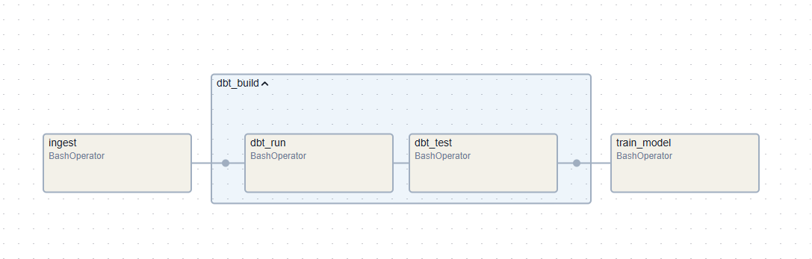

# 🚕 NYC Dynamic Surge Predictor

An end-to-end data engineering + ML pipeline that forecasts **hourly ride demand for each of NYC's 265 taxi zones, 1–3 hours ahead**, using 40M+ Uber/Lyft (FHVHV) trip records. Built with PySpark, Snowflake, dbt, LightGBM/XGBoost, MLflow, and Airflow, all containerized with Docker.


## Results

| Model | RMSE (trips/zone/hour) |
|---|---|
| Naive baseline (lag-1h) | 35.64 |
| HistGradientBoosting | 26.50 |
| XGBoost | 26.61 |
| LightGBM | 26.03 |
| **LightGBM (Optuna-tuned, 90 trials)** | **25.82** |
| **Out-of-sample: February holdout** | **26.18** |

- ~27% lower error than the naive baseline
- Only ~1.4% degradation on a fully unseen month, so the model generalizes



## Architecture



<!-- optional: replace/supplement mermaid with a polished diagram -->

## Tech Stack

| Layer | Tools |
|---|---|
| Ingestion & cleaning | PySpark, Folium |
| Warehouse | Snowflake |
| Transformation & testing | dbt (staging, intermediate, marts, 9 data tests) |
| Modeling | LightGBM, XGBoost, scikit-learn, Optuna |
| Experiment tracking | MLflow (SQLite backend) |
| Orchestration | Airflow |
| Infrastructure | Docker Compose (Jupyter/Spark, MLflow, Airflow) |

## Pipeline Walkthrough

### 1. Ingestion & cleaning (PySpark)
- Loaded January and February [YEAR] FHVHV parquet files (~20.9M and ~19.9M raw rows)
- Dropped duplicates and invalid trips (~0.5% of rows), joined the TLC zone lookup, and derived `pickup_hour`, `day_of_week`, `is_weekend`
- Cleaned counts: **20,835,763** (Jan) and **19,867,132** (Feb)
- Uber/Lyft split: ~73% / 27%

### 2. Warehouse & staging (Snowflake + dbt)
- Bulk-loaded via `PUT` + `INFER_SCHEMA` + `COPY INTO`
- `stg_fhvhv_trips` converts microsecond-epoch integers to timestamps and enforces types
- **9 dbt tests** (`not_null`, `accepted_values`, `relationships`) validate keys, license codes, and zone IDs

### 3. Feature engineering (dbt)
- `int_hourly_zone_demand`: hourly pickup counts per zone
- `fct_zone_features`: a zero-filled zone × hour grid (**265 zones × 744 hours = 197,160 rows** for January) with:
  - Lag features (1–3h)
  - Rolling averages (3h / 24h) that **exclude the current hour** to prevent leakage
  - Calendar and holiday flags

### 4. Modeling & tracking (MLflow)
- Trained naive, HistGBDT, LightGBM, and XGBoost baselines, all logged to MLflow
- 90-trial Optuna search on LightGBM with the native MLflow callback
- Best config: `n_estimators=400, learning_rate=0.0481, max_depth=8, num_leaves=98`
- January used for training/validation; **February held out entirely** for the final evaluation

### 5. Orchestration (Airflow)
`ingest → dbt run → dbt test → train_model`, with each step calling into the Jupyter container via `docker exec`.



## Engineering Challenges

- **Train/test leakage:** My first Jan/Feb split accidentally mixed February data into training. I caught it before reporting results, fixed it, and re-ran. The 26.18 figure above is leak-free.
- **Dependency conflicts:** `dbt-snowflake` broke Airflow's pip resolver, so dbt lives in the Jupyter image and Airflow triggers it via `docker exec`.
- **Spark OOM (exit 137):** Fixed by raising WSL2 memory, trimming worker memory, reducing executor cores/shuffle partitions, and removing redundant `.count()` calls.
- **Config persistence:** `profiles.yml` kept vanishing on container restarts, so it now lives in the repo (`.dbt/`) with `--profiles-dir`, using env vars for credentials.
- **Snowflake trial expiry:** Migrated accounts mid-project and rebuilt everything from the repo, which confirmed the dbt project is reproducible.

## Repo Structure

```
├── dags/                  # Airflow DAG
├── docker/                # Dockerfiles (Jupyter/Spark, MLflow, Airflow)
├── [dbt project folder]/  # staging, intermediate, marts, seeds, tests
├── notebooks/             # EDA, staging, feature selection
├── src/                   # ingest.py, train.py
├── docker-compose.yml
└── .env.example
```

## Getting Started

```bash
git clone https://github.com/sejalnimkar/NYC-Taxi-Dynamic-Surge-Predictor.git
cd NYC-Taxi-Dynamic-Surge-Predictor
cp .env.example .env     # add your Snowflake credentials
docker compose up -d
```

| Service | URL |
|---|---|
| Jupyter | localhost:8888 |
| MLflow | localhost:5000 |
| Airflow | localhost:8080 |
| Spark UI | localhost:9090 |

Data: download FHVHV parquet files and the zone lookup from the [NYC TLC Trip Record page](https://www.nyc.gov/site/tlc/about/tlc-trip-record-data.page).

## Future Work
- [Pick 2–3 real ones: e.g. weather/event features, multi-horizon models, serving the model via an API, a Tableau/Streamlit dashboard]

## Author
**Sejal** · MS Data Science, Indiana University Bloomington · [LinkedIn](#)
